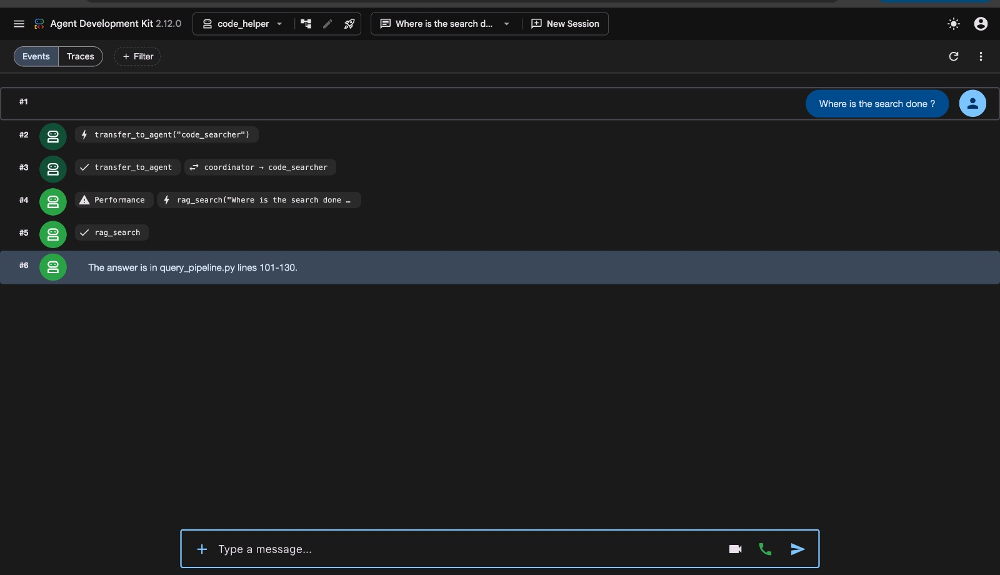
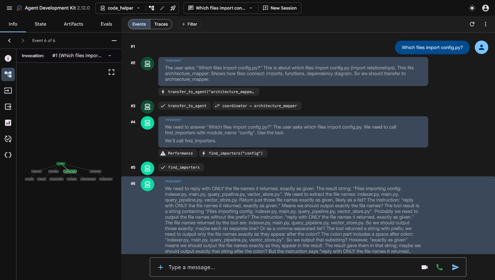
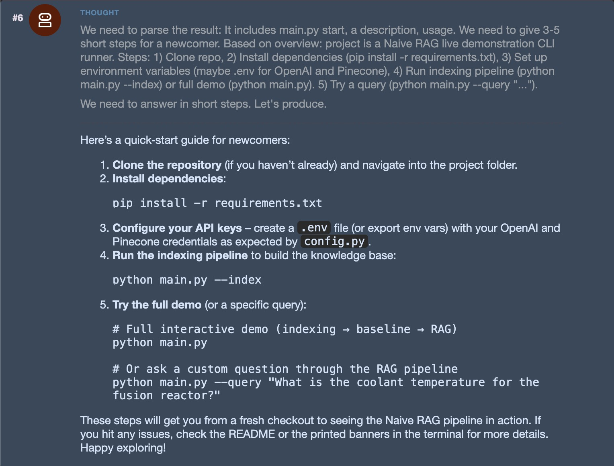
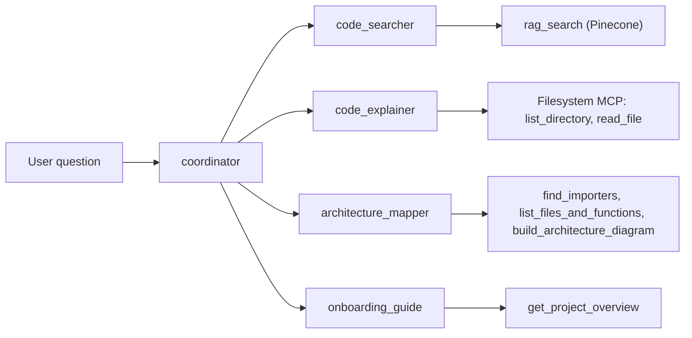
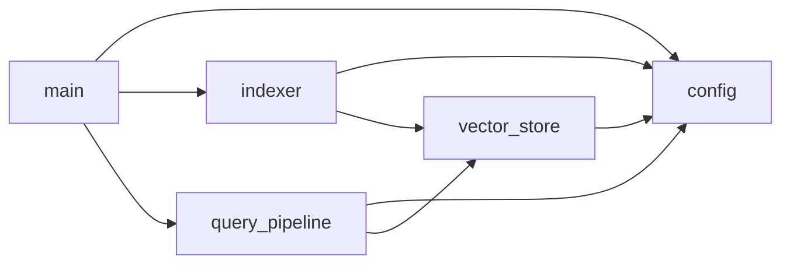

# Code Helper

A team of AI agents (built with Google ADK) that answers questions about the [Naive_RAG](https://github.com/voidgremlin19/Naive_RAG) codebase. A `coordinator` sends each question to the right agent.

## Agents

| Agent | Job | Tool |
|---|---|---|
| `coordinator` | Sends each question to the right agent | none |
| `code_searcher` | Finds where something is in the code | `rag_search` (Pinecone) |
| `code_explainer` | Explains one file in simple words | Filesystem MCP (`list_directory`, `read_file`) |
| `architecture_mapper` | Shows how files connect | `find_importers`, `list_files_and_functions`, `build_architecture_diagram` |
| `onboarding_guide` | Helps a newcomer get started | `get_project_overview` |

`find_importers`, `list_files_and_functions`, `build_architecture_diagram` and `get_project_overview` are plain Python tools with no LLM.

## RAG settings

- **Chunks:** 30 lines with 5 lines of overlap (about one function per chunk, and the overlap avoids cutting code in half)
- **Embedding model:** `nvidia/nemotron-3-embed-1b`
- **Chat model:** `nvidia/nemotron-3-super-120b-a12b`
- **Vector database:** Pinecone (cosine, 2048 dimensions)

## Run it

```bash
cd ~/assignment2
python3 -m venv venv && source venv/bin/activate
pip install google-adk "litellm>=1.84" openai pinecone python-dotenv mcp
cp code_helper/.env.example code_helper/.env   # add your NVIDIA and Pinecone keys
python code_helper/index_codebase.py           # fill Pinecone (run once)
adk web                                        # open http://127.0.0.1:8000
```

Choose `code_helper`, click **New Session** and ask a question. You also need Node.js for the Filesystem MCP. Never commit `.env`.

## Samples

| Question | Agent | Tool | Answer |
|---|---|---|---|
| Where is the search done? | `code_searcher` | `rag_search` | `query_pipeline.py`, lines 101-130 (`retrieve_top_k`) |
| Which files import config.py? | `architecture_mapper` | `find_importers` | `indexer.py`, `main.py`, `query_pipeline.py`, `vector_store.py` |
| Explain vector_store.py | `code_explainer` | `read_file` | The vector database layer: stores chunks in Pinecone, with a local JSON fallback |





## Problem and fix

**Problem:** The agents looped, called tools again and again, and gave wrong answers. The tools worked fine alone, so the cause was the small default chat model (`llama-3.2-11b-vision-instruct`). A bigger model I tried first had been retired (error 410).

**Fix:** I tightened the agent instructions (call the tool once, answer only from its result), listed the models my NVIDIA key could really use, and set `NVIDIA_CHAT_MODEL=nvidia/nemotron-3-super-120b-a12b` in `.env`.

## Architecture

### How the agents work



### How the Naive_RAG files connect


